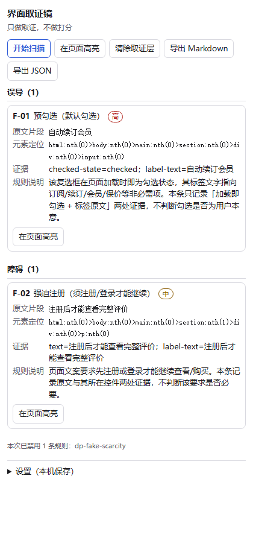

# 界面取证镜 · pattern-lens

> 点一下扩展图标，侧边栏列出当前页所有**可疑模式（待核对）**——每条给规则名、原文片段、元素定位、严重度，
> 页面上用编号徽标高亮取证，一键导出证据包。
> **做取证，不做打分**：没有证据节点，就不产出结论。

Chrome / Edge **Manifest V3** 浏览器扩展 · 零后端 · 零第三方依赖 · 零上传 · 无远程代码。



## 状态

| 里程碑 | 内容 | 状态 |
| --- | --- | --- |
| M0 | 计划套件 + 方法论装订 + 可运行骨架（规则数据 / 判定核心 / 导出 / 门 / CI） | ✅ 2026-10-18 |
| M1 | 数据先行：40 页合成 fixture + 逐页真值 + 覆盖矩阵 + 确定性生成器 | ✅ 2026-10-19 |
| M2 | 规则引擎与按需注入：12 条规则双边达标、证据门禁、权限白名单 | ✅ 2026-10-19 |
| M3 | 页内取证高亮层：Shadow DOM 覆盖层 + 编号徽标 + 双向联动 | ✅ 2026-10-19 |
| M4 | 侧边栏取证台：四组分组 + `storage.session` 恢复 + 站点级折叠 | ✅ 2026-10-19 |
| M5 | 导出与设置：Markdown/JSON 导出、黑白名单、规则开关、隐私声明、商店素材、README 定稿 | ✅ 2026-10-19 |
| M6 | 发布：公开仓库 + `v0.1.0` tag + Release（确定性 zip）+ 发布留档 | ✅ 2026-10-19 |

> **当前状态：M0–M6 全部完成（v0.1.0 已发布）**——
> **M2 起扩展已能真扫页面**（点击图标 → 按需注入 → 引擎判定 → 结果回传落 `storage.session`）；
> **M3 起页内取证层可用**（编号徽标挂在 Shadow DOM 覆盖层里；点条目滚动闪光、点徽标回高亮侧边栏条目；清除后页面"像没被碰过"）；
> **M4 起侧边栏取证台可用**（四组分组来自规则包；关掉再开、SW 被回收后重开仍恢复上次结果；同站点多次扫描按时间倒序折叠）；
> **M5 起导出与设置可用**（Markdown/JSON 一键导出、站点黑白名单、规则逐条开关、隐私声明与商店素材齐全）；
> **M6 起已发布**（[Release v0.1.0](https://github.com/yuluo554/pattern-lens/releases/tag/v0.1.0)，
> 附件 = 确定性 zip；CI 首推 4/4 绿）。
> 里程碑细节与已知未验证项见 [`plan/06-里程碑与每周演示.md`](plan/06-里程碑与每周演示.md)。

## 安装

**方式一：从源码加载（开发/自用）**

```bash
git clone https://github.com/yuluo554/pattern-lens.git
cd pattern-lens
node --version        # 需要 >= 22（本项目在 v24.15.0 实测）
npm run build         # 产出 dist/（可 Load unpacked 的扩展树）
```

然后打开 `chrome://extensions` → 打开右上角**开发者模式** → 点**加载已解压的扩展程序** → 选 **`dist/` 目录**。

> **不需要 `npm install`**：`dependencies` 与 `devDependencies` 均为空，`git clone` 后可直接跑 `npm run build` / `npm test`。
> 扩展要求 Chrome / Edge **116+**（`chrome.sidePanel.open()` 的起点——`sidePanel` 命名空间出现得更早，但本扩展靠 `open()` 开面板，而 `open()` 要求 116；`manifest.json` 已声明 `minimum_chrome_version`）。

**方式二：从 [Release](https://github.com/yuluo554/pattern-lens/releases/tag/v0.1.0) 下载 zip** —— 解压后同样在 `chrome://extensions` 里"加载已解压的扩展程序"。

## 使用

1. 打开任意网页，**点击工具栏上的扩展图标** → 右侧打开"界面取证镜"侧边栏（此时才注入扫描器，**未点击前零注入**）。
2. 点**开始扫描** → 侧边栏按**四组**（紧迫 / 误导 / 障碍 / 价格）列出发现的可疑模式，每条含：
   **规则名 · 严重度 · 原文片段 · 元素定位 · 证据 · 规则说明**。
3. 点条目上的**在页面高亮** → 页面滚动到对应位置并闪一下；点页面上的**编号徽标** → 侧边栏对应条目高亮（**双向联动**）。
4. 点**导出 Markdown** / **导出 JSON** → 证据包下载到本机（`pattern-lens-evidence-<host>-<时间戳>.{md,json}`）。
5. 点**清除取证层** → 页面上所有徽标与高亮消失，页面恢复原样（清除后 DOM diff = 0）。
6. 展开**设置**：站点策略（黑名单 = 列出的站点不扫描；白名单 = 只扫描列出的站点）、逐条**规则开关**。

> **右键菜单**：在页面上右键 → "用界面取证镜检查本页"，也会打开侧边栏并开始扫描。

## 内置规则（12 条，首批）

分组顺序与严重度分级来自规则包（`rules/manifest.json` 的 `categories` / `severity_levels`），**UI 不写死**。
每条规则都声明 `evidence_required`：**取不到证据节点就不产出结论**（把每条结论钉在可复核的 DOM 节点与原文上）。

| 规则 id | 名称 | 分组 | 严重度 | 需要的证据 |
| --- | --- | --- | --- | --- |
| `dp-prechecked-optin` | 预勾选（默认勾选） | 误导 | 高 | 勾选状态 + 标签文本 |
| `dp-hidden-close` | 隐形关闭（关闭控件不可见或极小） | 障碍 | 高 | 尺寸 + 前景/背景色 + 标签文本 |
| `dp-countdown-pressure` | 倒计时施压 | 紧迫 | 中 | 文本 |
| `dp-fake-scarcity` | 稀缺表述且无可核对来源 | 紧迫 | 中 | 文本 + 周边文本 |
| `dp-confirmshaming` | 确认羞辱（把拒绝写成贬损选项） | 误导 | 中 | 文本 + 标签文本 |
| `dp-anchored-discount` | 锚定折扣（划线价无可核对来源） | 价格 | 中 | 文本 + 周边文本 |
| `dp-default-addon` | 默认加购（附加项默认选中） | 误导 | 中 | 勾选状态 + 标签文本 |
| `dp-exit-retention` | 退出挽留文案 | 障碍 | 中 | 文本 + 周边文本 |
| `dp-subscription-trap` | 订阅取消渠道受限（仅电话/客服） | 障碍 | 高 | 文本 + 周边文本 |
| `dp-hidden-fee` | 费用后置（结账阶段才出现费用） | 价格 | 高 | 文本 + 周边文本 |
| `dp-forced-signup` | 强迫注册（须注册/登录才能继续） | 障碍 | 中 | 文本 + 标签文本 |
| `dp-dark-close` | 低对比关闭控件 | 误导 | 中 | 对比度 + 前景/背景色 + 标签文本 |

**规则可逐条开关**：被禁用的规则**不参与扫描、也不出现在导出**（导出里 `ruleset.disabled_rule_ids` 会写明这份证据包用了哪些规则）。
每条规则还带 `limits` 字段，显式声明"本工具**不**判断什么"。

## 隐私

零采集、零上传、零遥测、无远程代码。扫描结果只存本机（`chrome.storage.session`），设置存 `chrome.storage.local`。
权限只申请 `activeTab`、`scripting`、`sidePanel`、`storage`、`contextMenus` 五项；**不申请** `<all_urls>`、`tabs`、
`cookies`、`webRequest`、`history`、`clipboardRead`、`downloads`；`host_permissions` 为空。
**未点击扩展图标前，不向任何页面注入任何脚本。**
详见 [`docs/隐私声明.md`](docs/隐私声明.md)。

## 开发与自检

```bash
npm run layout         # 布局门：项目是否仍长在方法论上（AGENTS.md 那条；续接对话第一件事）
npm test               # 全部测试（node --test，零依赖，不需要 npm install）
npm run verify         # 一条命令全量自检（rc=0 全绿；未启用段以 not_enabled 显式列出）
npm run verify:strict  # 未启用段必须清零（M6 用）
npm run build          # → dist/（可 Load unpacked 的扩展树）+ 确定性 zip + SHA256SUMS
npm run build:check    # 重生成逐字节一致自检
node tools/check-release.mjs           # 发布终态自检（离线；tag/远端项报 SKIP，不冒充通过）
node tools/check-release.mjs --online  # 终态（需远端：仓库公开 / tag 两端一致 / CI run 对账 / 附件 sha256）
npm run rules:hash     # 重算规则包内容哈希，写回 rules/manifest.json
npm run fixtures       # 生成 40 页合成 fixture + 逐页真值 + 覆盖矩阵（data/fixtures/）
npm run fixtures:check # 再生成位级比对（冻结产物与重生成结果逐字节一致）
npm run bench          # 规则基准 B1–B7：12 规则 × 40 页逐样本点名（precision/recall 双边门、误报 0、5k 耗时）
npm run smoke:overlay  # 浏览器冒烟：页内覆盖层真实点击双向联动（缺浏览器显式 SKIP）
npm run smoke:export   # 浏览器冒烟：真实导出字节 + 整轮扫描/导出远程请求计数（缺浏览器显式 SKIP）
npm run store:icons    # 生成 assets/store/ 图标（确定性）；store:icons:check 重生成比对
npm run store:screenshots # 用真实浏览器渲染产出商店截图（缺浏览器显式 SKIP）
```

> fixture 是**生成物**：手工改了页面就得同步改同目录 `truth.json`，否则 `npm run fixtures:check` 会红。
> 想直接看植入的可疑模式：浏览器打开任一 `data/fixtures/page-NN/page.html`（如 6×6 的"关闭"按钮、前景≈背景的关闭控件）。

> 本项目遵循 [`ai-tool-project-sprint`](AGENTS.md) 方法论（装订 2026-10-18）：
> 仓库锚点见 [`AGENTS.md`](AGENTS.md)，布局门 `tools/check-sprint-layout.mjs` 在 CI 里有一条步骤。

## 它是什么 / 不是什么

| 是 | 不是 |
| --- | --- |
| 逐条可疑模式的**取证**：规则名 + 原文片段 + 元素定位 + 严重度 | ❌ 不给"暗黑模式分数""欺诈指数" |
| 只读**渲染后 DOM**（文本节点、计算样式、几何），不上传、不截图 | ❌ 不做页面存档、不保存用户输入 |
| 每条规则声明 `evidence_required`：取不到证据就不产出结论 | ❌ 用模型猜、用 ML 打分 |
| 规则可逐条开关、规则包随包版本化、阈值单一真相源 | ❌ 远程拉规则（MV3 禁止远程代码） |
| 导出 Markdown / JSON 证据包，供人工复核 | ❌ 不自动点击、不代用户取消订阅 |

**为什么不用 LLM 聊天代替**：聊天模型拿不到你**当前这一页渲染后的 DOM**——看不到哪个复选框是页面加载时就被勾上的、
哪个关闭按钮被做成了背景色、哪个"仅剩 2 件"背后没有任何库存来源。

## 局限披露（不藏缺口）

- **判定本质是启发式**：每条结论只说明"观察到了什么 + 命中了哪条规则"，**不是**对站点的事实认定或法律意见。
- **真实渲染路径**：Node 侧基准跑的是**声明的样式子集**（不是浏览器计算样式）；真实计算样式由浏览器冒烟单独覆盖，
  缺浏览器时该命令显式 SKIP 并记入已知未验证项——**不用"没跑"冒充"跑过"**。
- **浏览器冒烟只覆盖 `page-01`**：`npm run smoke:overlay` / `npm run smoke:export` 在**真实浏览器**里跑通，
  但只冒烟了一页 fixture，其余 39 页未逐页冒烟；且冒烟**不进 CI**（CI 无浏览器）。
- **侧边栏验收面**：侧边栏的 DOM 侧判据是**假 DOM + 假 chrome 运行时上的本地等价校验**；真实浏览器里
  由 `npm run smoke:export` 覆盖（真加载、真渲染、真导出 Blob），但仍只覆盖一页 fixture。
- **`storage.session` 在浏览器重启后会被清空**：本项目只验"扩展后台被回收后恢复"，**未验浏览器重启后恢复**（平台语义）。
- **基准是合成基准**：40 页 fixture 全部自建（虚构站点名），因此任何 precision/recall 数字的分母是合成基准，
  **不是**真实站点统计。
- **商业侧未核验**：Chrome 应用商店在基准日（2026-10-17）本机不可达，故 README 不写"商店里没有同类产品"这类断言。
- **首期范围**：12 条规则；规则包热更新、多语言 UI、PDF 导出为 roadmap。
- **浏览器兼容**：首期只支持 Chrome / Edge 116+（`chrome.sidePanel.open()` 起点——`sidePanel` 命名空间出现得更早，但本扩展靠 `open()` 开面板）。
- **CI 已实跑**：首推 4/4 绿（`ubuntu`/`windows` × Node 22/24），branch run 与 tag run 两条均 success。

## 许可

[MIT](LICENSE) © 2026 yuluo554（无担保；工具结论仅供人工复核，不构成法律意见或事实认定）。
